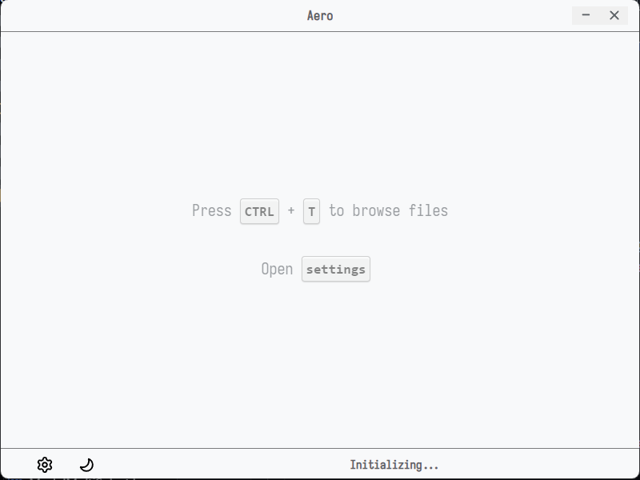

# <p align="center">Aero</p>

**A lightweight, fully-customizable, supercharged text editor at your fingertips.**

> **Status:** early development so breaking changes or unfinished features are likely to be encountered.

> At the time of writing there is currently no plans or roadmap for product completion. 



## Project structure

| Path | Description |
| --- | --- |
| `crates/engine` | Contains shared types used by the frontend. |
| `crates/web` | wasm bindings for the engine. |
| `crates/desktop` | The desktop app built on [tao](https://github.com/tauri-apps/tao) and [wry](https://github.com/tauri-apps/wry). |
| `packages/ui` | Components making up the ui and webgl renderer. |
| `packages/bootstrap` | Contains the generators ran when building and produces assets used by the runtime. |
| `static` | Contains static files and bundled assets used by the app. |

## Requirements

- [Rust](https://rustup.rs) (The current `rust-toolchain.toml` installs the `wasm32-unknown-unknown` target automatically)
- [wasm-pack](https://rustwasm.github.io/wasm-pack/installer/) for running the wasm code generation
- [Node.js](https://nodejs.org) 20 or newer (be sure to run `corepack enable`) to get the pinned Yarn version
- **Linux only**, for the desktop app:
  ```sh
  sudo apt install libwebkit2gtk-4.1-dev libgtk-3-dev libsoup-3.0-dev libjavascriptcoregtk-4.1-dev libxdo-dev
  ```
  > **Windows** uses WebView2 which is already shipped with Windows 10/11. macOS uses the system WebKit.

## To get started

Clone this repo then open a terminal in the project root with: 
```sh
yarn install
```

Give it a few minutes to finish installing and running the necessary setup. Once finished,
you may then launch the browser or desktop app.

### Run in the browser

```sh
yarn dev
```

This will compile the wasm crate then start the dev webpack server which is accessible at <http://localhost:8080>.

### Run the desktop app

Open a new terminal and run `yarn dev` to start the desktop app in development:

```sh
cargo run -p aero-desktop
```

| Variable | Default | Description |
| --- | --- | --- |
| `AERO_CHANNEL` | `development` | Valid values are `development`\|`production`. `development` loads the dev server with devtools enabled. |
| `AERO_HOST` | `localhost` | The address which the application serves. |
| `AERO_PORT` | `8080` | The port which the application serves. |
| `RUST_LOG` | `info` | Log level used by the logging configuration. For more information on behavior and configuration specifics see [env_logger](https://docs.rs/env_logger). |

## Useful commands

| Command | Description |
| --- | --- |
| `yarn build` | Runs the build pipeline for `production`. |
| `yarn generate-icons` | Generates `packages/ui/src/components/octicon/octicons.ts` from `@primer/octicons`. |


## Acknowledgements

- The authors and contributors of [Atom](https://github.com/atom/atom), for a product that changed the standards of quality and usability for text editors. As someone who greatly enjoyed using Atom this was an invaluable reference during the making of this application.
- The creators of [Tree-sitter](https://tree-sitter.github.io/tree-sitter/), whose work taught me a great deal about the algorithms, mechanisms and designs behind language processing.
